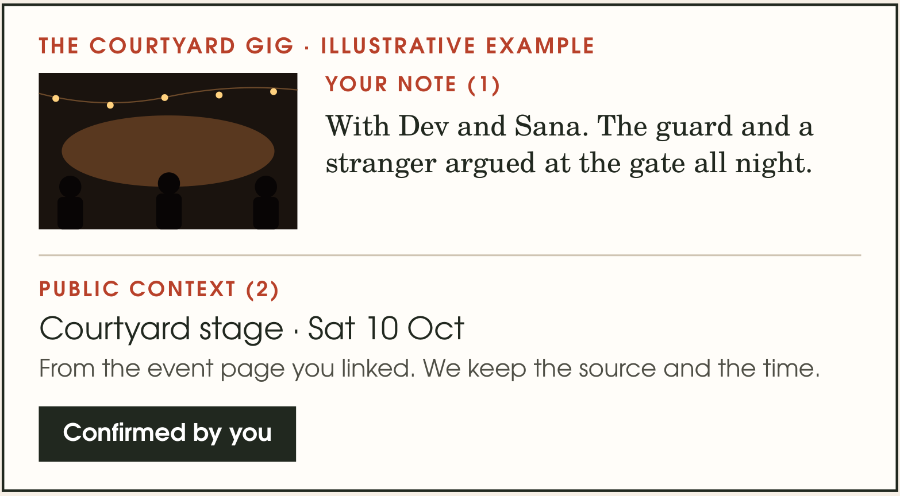

# Schema

**The story behind your photos.**

A photo keeps the scene. Schema keeps the people, places and small details that made it matter. It is a private scrapbook for young adults who want their memories to feel like their own pages, with photos, personal notes and an archive they can revisit.

[Pitch deck](submission/Schema_Kritical_Round1.pdf) · [PowerPoint](submission/Schema_Kritical_Submit.pptx) · [Economics model](submission/Schema_Kritical_Economics.xlsx)



## What it does

- Create a journal page with photos and your own words.
- Keep pages together in a chronological life archive.
- Add public event context through TinyFish, then choose each fact before it enters a draft.
- Keep the source link and retrieval time alongside the selected context.
- Control which saved pages the optional memory assistant can use.

The scrapbook above is an illustrative page. Public event information stays distinct from the user's personal account of the day.

## Why TinyFish belongs here

An event's name, venue and program can sit across interactive tabs and schedules. TinyFish's Web Agent browses the public page and returns structured candidates. Schema turns those candidates into a draft only after the user reviews them.

1. The user supplies a public HTTPS event link and agrees to research it.
2. The server authenticates the account, validates the URL and reserves its research allowance.
3. TinyFish starts an asynchronous browser job with a fixed extraction goal and a **120-second provider time limit**.
4. Schema polls the run using a signed token tied to its owner.
5. The user selects facts. The draft builder includes only those selections, their source and retrieval time.

Private journal text and photos never enter the TinyFish request. The provider key stays on the server. Failed research leaves the journal unchanged.

The current deployment uses TinyFish's generally available time limit. Custom step limits require beta access and are not sent by this version. Six-step and twelve-step economics scenarios are cost-model assumptions, not guaranteed limits on a live run.

Implementation: [provider calls](lib/tinyfish/provider.mjs), [HTTP route](app/api/tinyfish/route.ts), [review interface](app/tinyfish-context.tsx) and [draft builder](lib/tinyfish/context.mjs).

A live TinyFish provider run extracted PyCon US 2026's dates, venue and program sections in five steps. Its [recorded result](evidence/tinyfish-live-provider.json) identifies the source and capture method.

## Run the TinyFish workflow

Use Node 24 and pnpm 11.25. This command runs research and reviewed-draft creation without setting up the web app's account database.

```bash
pnpm install --frozen-lockfile
pnpm demo:tinyfish --url https://us.pycon.org/2026/ --fields title,venue
```

Set `TINYFISH_API_KEY` in your shell or secret manager before a live run. The command prints the returned facts, saves a source-labelled draft under `.demo/memories/`, then reopens it from disk. `--fields` specifies the facts you approve. Run without `--fields` to choose interactively.

To inspect the draft workflow using the recorded provider result, with no API call or credit use:

```bash
pnpm demo:tinyfish --example --fields title,venue
```

Recorded mode is labelled in both the terminal and saved file.

## Run the web app

Copy `.env.example` to `.env.local` and configure Supabase Auth, Postgres and private storage using the [setup guide](docs/KRITICAL_SETUP.md). Enable TinyFish with its server key and approved demo-account emails.

```bash
pnpm customer:dev
```

Open `http://localhost:3000`, sign in, and open **My life** to add event context. A hosted deployment uses the same server variables and `pnpm customer:build`.

## Technical approach

| Layer | Implementation |
|---|---|
| Interface | Next.js, React and TypeScript |
| Accounts and records | Supabase Auth and Postgres with row-level security |
| Media | Private object storage |
| Web research | TinyFish asynchronous Web Agent |
| Draft creation | Per-field approval with source provenance |
| Optional memory answers | Consent-based retrieval of permitted journal text with source references |

The current memory retrieval adapter ranks keyword matches. Semantic memory connections and native mobile apps are future work.

## Price economics

The proposed model offers a limited free plan and **Plus at ₹149/month**, with explicit storage, AI and research allowances. Typical modeled variable cost is about **₹27 per paid user per month**. After illustrative tax and payment-fee assumptions, about **₹96** remains before free-user subsidy and shared fixed costs.

The [workbook](submission/Schema_Kritical_Economics.xlsx) contains formulas, usage assumptions, competitor prices, source links and a full-allowance stress case. These are proposed prices and modeled costs. Billing is disabled in the prototype.

## Checks

```bash
pnpm test
pnpm check
pnpm customer:build
```

Tests cover research limits, signed run ownership, selected-fact drafts, journal persistence and account isolation. [GitHub Actions](https://github.com/biney25/schema-kritical-hacks-2026/actions) runs the same checks.

## Development

Built for the AI/ML Student Track at Kritical Hacks 2026. This repository extends Schema's existing codebase with bounded TinyFish event research, reviewed draft creation and the competition submission. Earlier development remains in the imported commit history. See [source provenance](docs/PROVENANCE.md).
